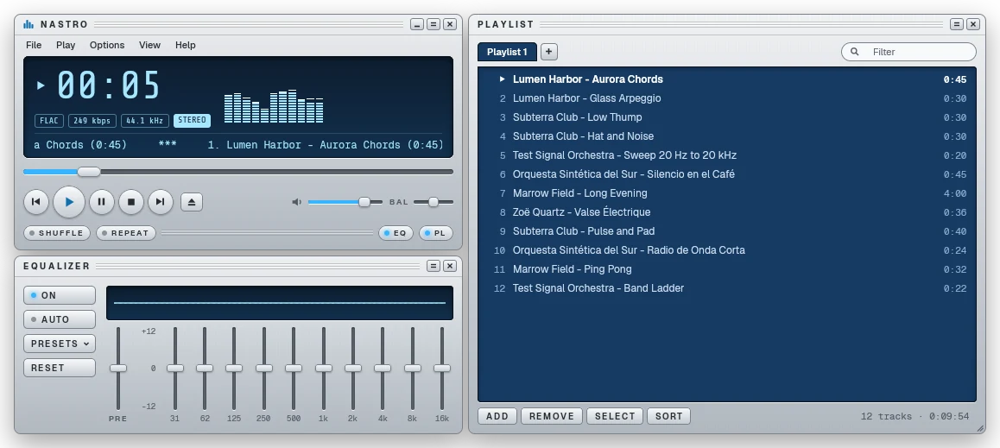
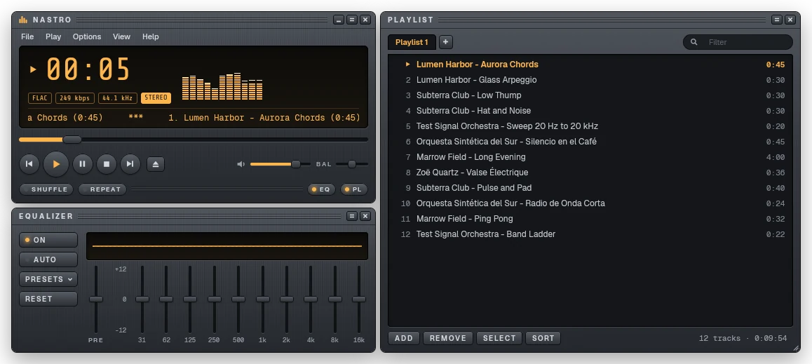
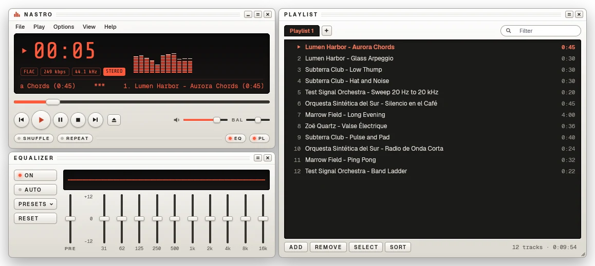
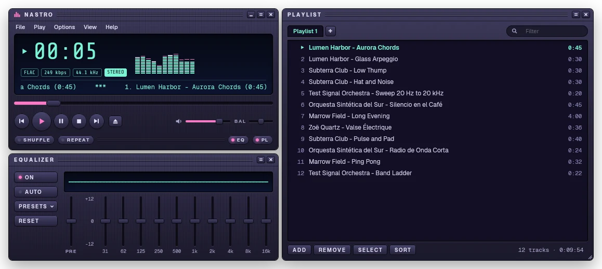

# Nastro

A lightweight, skinnable desktop music player, without accounts and without telemetry. It plays
the audio files on your computer. The player, a 10-band equalizer and the playlist dock together
with magnetic snapping, and the look is a skin: four are built in (Silver, Graphite, Porcelain
and Nebula), you can write your own as a plain `skin.toml`, and importing classic skins is
planned.

[Website](https://nastro.tanis.codes) · [Download](https://nastro.tanis.codes/install.html) ·
[Documentation](#documentation) (the website address is provisional)



The same window in the other built-in skins, Graphite, Porcelain and Nebula:

<p>
  
  
  
</p>

> Status: early development. Linux comes first, and the Windows and macOS builds have not been
> verified yet.

## Goals

- Cross-platform desktop app: Linux, Windows and macOS.
- Written in Rust, with the UI built on [`gpui`](https://crates.io/crates/gpui), the
  GPU-accelerated framework behind the Zed editor.
- A classic layout that you can restyle: player, equalizer and playlist panels, docked together
  with magnetic snapping.
- **No login, no telemetry, no online sync.** It plays local files and nothing leaves your
  machine.
- Its own audio pipeline (decoding, resampling, equalizer, analysis and output), so the
  equalizer, the visualizer and gapless playback stay under our control.
- Light: an idle window does no work.
- Fully open source.

## Supported formats

Decoding is done by [Symphonia](https://github.com/pdeljanov/Symphonia), in pure Rust.

| Format | Extensions | Codecs |
| --- | --- | --- |
| FLAC | `flac` | FLAC |
| MP3 and MPEG audio | `mp3`, `mp2`, `mp1` | MP3, MP2, MP1 |
| Ogg | `ogg`, `oga` | Vorbis, FLAC |
| WAV | `wav`, `wave` | PCM, ADPCM |
| AIFF | `aif`, `aiff`, `aifc` | PCM |
| MPEG-4 audio | `m4a`, `mp4`, `m4b`, `aac` | AAC, ALAC |
| Core Audio | `caf` | PCM, ALAC, AAC |
| Matroska and WebM | `mka`, `mkv`, `webm` | FLAC, Vorbis, MP3, AAC, ALAC, PCM |

Not supported yet: Opus (`.opus` files, and Opus inside Ogg, Matroska or WebM), WavPack and
Monkey's Audio. Gapless playback covers MP3, FLAC, Vorbis and ALAC; AAC plays with the encoder
gap. Playlists are read and written as M3U (`m3u`, `m3u8`).

## Building from source

Install Rust with [`rustup`](https://rustup.rs). The toolchain version is pinned in
`rust-toolchain.toml` and installed on the first build. Then install the system dependencies for
your platform:

- **Linux** (Debian and Ubuntu package names; on Fedora use `alsa-lib-devel` instead of
  `libasound2-dev`):

  ```
  sudo apt install build-essential pkg-config cmake libfontconfig-dev libfreetype-dev \
      libwayland-dev wayland-protocols libxkbcommon-dev libxkbcommon-x11-dev \
      libx11-xcb-dev libxcb1-dev libvulkan-dev libasound2-dev
  ```

- **macOS**: Xcode, with its command line tools.
- **Windows**: the Visual Studio Build Tools with the "Desktop development with C++" workload.

Build and run:

```
git clone https://github.com/tanisperez/nastro.git
cd nastro
cargo run                    # debug build
cargo build --release        # optimized binary in target/release/nastro
cargo test --all-targets     # run the tests
```

On Linux and macOS the `Makefile` wraps the usual commands (`make run`, `make release`,
`make test`, `make lint`, ...). `make samples` generates a set of synthetic test tracks (needs
`ffmpeg`). Run `make help` for the full list.

On Linux, `make install` builds the optimized binary and installs it for your user under
`~/.local`: the binary, the menu entry and the icons (`PREFIX=` changes the place). The menu
entry is also what gives the window its icon on Wayland. `make install-latest` installs the
latest published release the same way, without building: it downloads the Linux tarball from
GitHub and checks it against the release's `SHA256SUMS`. `make uninstall` removes either.

## Documentation

The user guide is at <https://nastro.tanis.codes/docs/>. Reference documents in this repository:

- [Skin format](docs/skin-format.md): how to write a `skin.toml`.
- [Audio](docs/audio.md): the audio pipeline.
- [Releasing](docs/releasing.md): how versions are built and published.
- [Architecture](docs/architecture.md): the crates and how they fit together.

## License

Copyright 2026 Estanislao Pérez Nartallo.

Nastro is licensed under the [Apache License 2.0](LICENSE). See [NOTICE](NOTICE).
